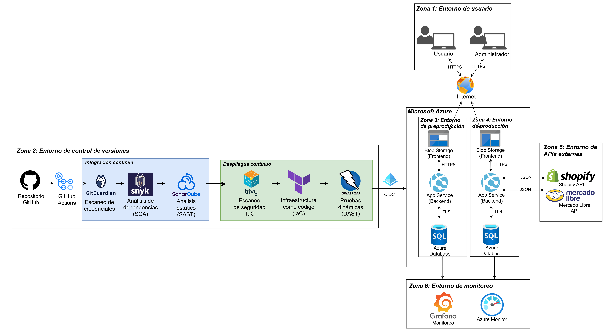
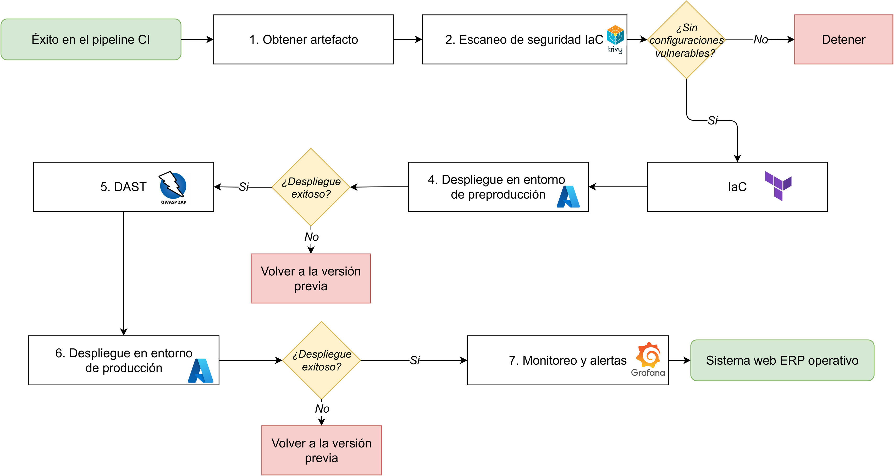
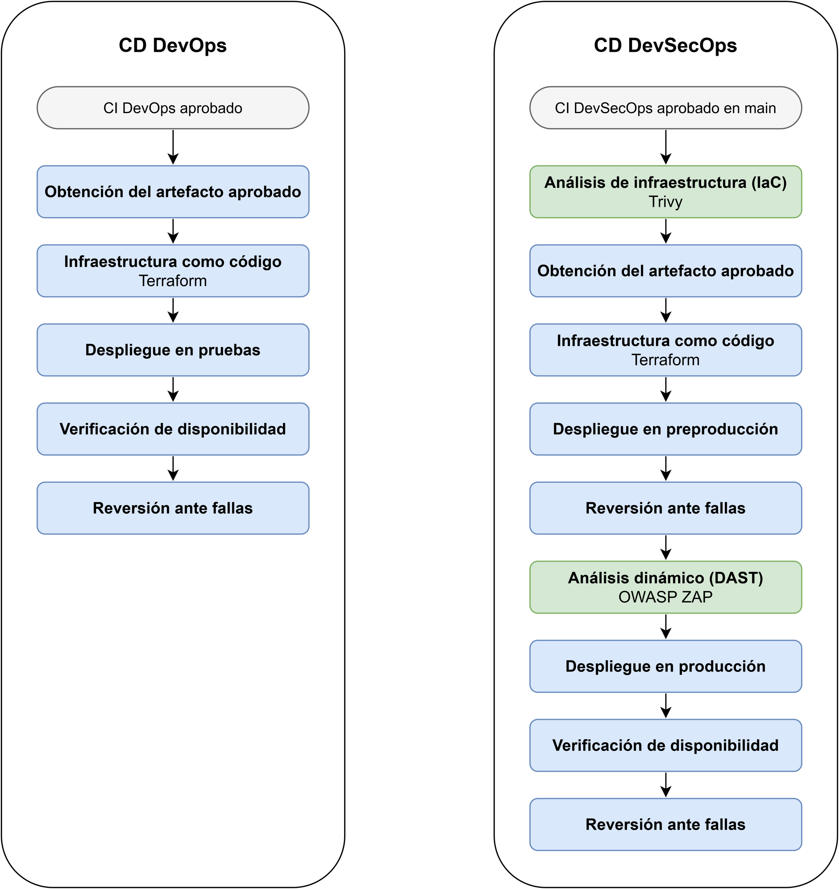

#  Zona Gaucha ERP

El presente proyecto se desarrolló entre marzo y noviembre de 2026 y consiste en un sistema web ERP con enfoque DevSecOps para la empresa Zona Gaucha Chile.

El sistema centraliza las ventas, compras e inventario de la empresa para consultar los registros desde una misma plataforma. Incorpora ventas de plataformas externas, permite ingresar registros manuales y relaciona los movimientos con sus productos, proveedores y lotes. El enfoque DevSecOps incorpora controles de seguridad y calidad durante la integración y el despliegue del software.

## Acceso al entorno de staging

El entorno de preproducción está disponible para probar las funciones del sistema. Contiene datos de prueba y registros simulados para la demostración.

| Acceso | Administrador | Usuario |
| --- | --- | --- |
| URL | [Abrir el sistema en staging](https://zgerpfrontstg.z15.web.core.windows.net) | [Abrir el sistema en staging](https://zgerpfrontstg.z15.web.core.windows.net) |
| Correo | `zonagauchaprueba@gmail.com` | `usuarioprueba@gmail.com` |
| Contraseña | `proyectodetitulo2026` | `proyectodetitulo2026` |

## Arquitectura DevSecOps

La arquitectura organiza el proceso de desarrollo en capas de control de versiones, integración continua, seguridad del código, infraestructura como código, despliegue continuo, análisis dinámico y monitoreo. Cada capa reúne las herramientas que permiten revisar, publicar y observar los cambios del sistema.


## Modelo arquitectónico con enfoque DevSecOps

La aplicación utiliza Angular para la interfaz, Express para la lógica de negocio y Azure SQL para almacenar los datos. El backend mantiene una estructura monolítica organizada en rutas, controladores y modelos. En Azure, el frontend se publica en Storage y el backend en App Service, con entornos de preproducción y producción.



Las arquitecturas física, lógica y DevSecOps se presentan en el README de documentación.

## Pipelines

El flujo general conecta los cambios del repositorio con la integración y el despliegue continuo. Una vez aprobadas las pruebas de CI se publica el artefacto, se despliega en preproducción, se ejecutan las pruebas dinámicas y se continúa hacia producción. Las comprobaciones de disponibilidad permiten detectar errores de despliegue y volver a la versión anterior.


## Pipeline de integración continua

El frontend y el backend cuentan con workflows propios en GitHub Actions. El pipeline DevSecOps revisa la exposición de credenciales con GitGuardian, analiza dependencias con Snyk, ejecuta pruebas con cobertura y realiza el análisis estático con SonarCloud. El resultado del análisis debe cumplir el quality gate antes de publicar el artefacto.

| Componente | Ejecuciones y jobs | Definición |
| --- | --- | --- |
| Frontend | [CI del frontend](https://github.com/claudioignav/ZonaGaucha-ERP/actions/workflows/frontend-ci-devsecops.yml) | [Workflow](.github/workflows/frontend-ci-devsecops.yml) |
| Backend | [CI del backend](https://github.com/claudioignav/ZonaGaucha-ERP/actions/workflows/backend-ci-devsecops.yml) | [Workflow](.github/workflows/backend-ci-devsecops.yml) |


Al abrir una ejecución en Actions se pueden consultar sus jobs, duración y registros.

Como ejemplo, esta [ejecución del CI del frontend](https://github.com/claudioignav/ZonaGaucha-ERP/actions/runs/44601961348) muestra los cuatro jobs del análisis DevSecOps.

## Pipeline de despliegue continuo

El pipeline obtiene el artefacto aprobado, analiza la configuración Terraform con Trivy y despliega en preproducción. Luego ejecuta pruebas dinámicas con OWASP ZAP y continúa hacia producción. También comprueba la disponibilidad de la versión desplegada y contempla volver a la anterior ante errores de despliegue.

| Componente | Ejecuciones y jobs | Definición |
| --- | --- | --- |
| Frontend | [CD del frontend](https://github.com/claudioignav/ZonaGaucha-ERP/actions/workflows/frontend-cd-devsecops.yml) | [Workflow](.github/workflows/frontend-cd-devsecops.yml) |
| Backend | [CD del backend](https://github.com/claudioignav/ZonaGaucha-ERP/actions/workflows/backend-cd-devsecops.yml) | [Workflow](.github/workflows/backend-cd-devsecops.yml) |



Esta [ejecución del CD del frontend](https://github.com/claudioignav/ZonaGaucha-ERP/actions/runs/44602510981) permite consultar el análisis de infraestructura, el despliegue en preproducción, DAST y la publicación en producción.

## Experimentación del enfoque DevSecOps

La validación comparó un pipeline DevOps reducido con uno DevSecOps mediante cinco escenarios experimentales. Se evaluaron la detección de problemas de seguridad y calidad, los tiempos de entrega y la recuperación frente a despliegues defectuosos.



| Escenario | Ramas de los casos experimentales |
| --- | --- |
| Seguridad | [test/e2-seguridad](https://github.com/claudioignav/ZonaGaucha-ERP/tree/test/e2-seguridad) |
| Entrega | [DevOps](https://github.com/claudioignav/ZonaGaucha-ERP/tree/test/e4-entrega-devops) y [DevSecOps](https://github.com/claudioignav/ZonaGaucha-ERP/tree/test/e4-entrega-devsecops) |
| Mantenibilidad | [test/e1-mantenibilidad](https://github.com/claudioignav/ZonaGaucha-ERP/tree/test/e1-mantenibilidad) |
| Fiabilidad y calidad de pruebas | [Regresión](https://github.com/claudioignav/ZonaGaucha-ERP/tree/test/e3-regresion), [cobertura](https://github.com/claudioignav/ZonaGaucha-ERP/tree/test/e3-cobertura) y [corrección](https://github.com/claudioignav/ZonaGaucha-ERP/tree/test/e3-correccion) |
| Estabilidad | [test/e5-estabilidad](https://github.com/claudioignav/ZonaGaucha-ERP/tree/test/e5-estabilidad) |

| Pipeline evaluado | Integración continua | Despliegue continuo |
| --- | --- | --- |
| DevOps | Pruebas y preparación del artefacto. [Frontend](.github/workflows/frontend-ci-devops.yml) y [backend](.github/workflows/backend-ci-devops.yml). | Publicación en pruebas. [Frontend](.github/workflows/frontend-cd-devops.yml) y [backend](.github/workflows/backend-cd-devops.yml). |
| DevSecOps | Secretos, dependencias, pruebas, cobertura y análisis estático. [Frontend](.github/workflows/frontend-ci-devsecops.yml) y [backend](.github/workflows/backend-ci-devsecops.yml). | Análisis de infraestructura, preproducción, DAST y producción. [Frontend](.github/workflows/frontend-cd-devsecops.yml) y [backend](.github/workflows/backend-cd-devsecops.yml). |


En esta comparación, DevOps despliega en el entorno de pruebas. DevSecOps recorre preproducción, análisis dinámico y producción. La cantidad de entornos forma parte de la configuración evaluada y debe considerarse al comparar los tiempos de entrega.

## Stack tecnológico

| Componente | Tecnología | Uso |
| --- | --- | --- |
| Frontend | Angular 21 y TypeScript | Interfaz web y organización de los módulos. |
| Interfaz y estilos | Angular Material, Tailwind CSS y SCSS | Componentes visuales y presentación de las pantallas. |
| Backend | Node.js y Express 5 | API HTTP y procesamiento de las operaciones del ERP. |
| Acceso a datos | Sequelize y Tedious | Modelos, relaciones y conexión con SQL Server. |
| Base de datos | Azure SQL | Almacenamiento de cuentas, catálogos, compras, ventas e inventario. |
| Autenticación | JWT y bcrypt | Sesiones de usuario y protección de contraseñas mediante hash. |
| Alojamiento | Azure Blob Storage y App Service | Publicación del frontend y ejecución del backend. |
| Integraciones | APIs externas | Consulta e importación de ventas de las plataformas configuradas. |

## Herramientas

| Herramienta | Uso en el proyecto |
| --- | --- |
| Git y GitHub | Control de versiones, ramas y revisión de cambios mediante pull requests. |
| GitHub Actions | Ejecución de los pipelines de integración y despliegue continuo. |
| GitGuardian | Detección de credenciales y secretos expuestos en el código. |
| Snyk | Análisis de vulnerabilidades conocidas en las dependencias. |
| SonarCloud | Análisis estático, cobertura y evaluación del quality gate. |
| Jest y Supertest | Pruebas del backend y de sus rutas HTTP. |
| Vitest | Pruebas del frontend mediante Angular CLI. |
| Terraform | Definición y gestión de la infraestructura de Azure. |
| Trivy | Análisis de seguridad de la configuración de infraestructura. |
| OWASP ZAP | Pruebas dinámicas de seguridad en preproducción. |
| Grafana y Azure Monitor | Visualización de métricas y seguimiento del funcionamiento del sistema. |

## Prácticas de desarrollo

Los cambios se organizan en ramas y se integran mediante pull requests. El frontend y el backend mantienen sus propias pruebas y pipelines, lo que permite revisar cada componente antes de publicar una versión.

| Práctica | Aplicación |
| --- | --- |
| Pruebas automatizadas | Ejecución de pruebas y generación de reportes de cobertura en CI. |
| Controles DevSecOps | Revisión de secretos, dependencias, código e infraestructura, junto con pruebas dinámicas. |
| Infraestructura como código | Configuraciones Terraform separadas por entorno y componente. |
| Separación de entornos | Pruebas para la comparación DevOps y preproducción y producción para DevSecOps. |
| Gestión de credenciales | Variables de entorno y secretos de GitHub, con autenticación OIDC hacia Azure. |
| Control de acceso | Autenticación y permisos comprobados desde el backend. |
| Verificación y recuperación | Comprobación de la versión desplegada y recuperación de la anterior ante errores de despliegue. |

## Mantenimiento

El pipeline DevSecOps forma parte del sistema y se mantiene junto con el código. Para conservar sus controles al incorporar cambios se recomienda lo siguiente.

- **Respetar las reglas de subida de cambios.** Los cambios se trabajan en ramas y los commits siguen la convención del proyecto, con los prefijos feat, fix, test, style y refactor.
- **No subir cambios directamente a main.** Todo cambio llega a main mediante un pull request, para que el CI lo valide antes del despliegue.
- **Esperar que se completen los checks.** El pull request se integra solo cuando todos los checks del CI terminan correctamente.
- **No desactivar controles para que el pipeline pase.** Si GitGuardian, Snyk, SonarCloud, Trivy u OWASP ZAP detienen un cambio, se corrige la causa en el código o en la configuración. Quitar un job, bajar un umbral o saltarse el quality gate elimina la protección que entrega el pipeline.
- **Revisar los falsos positivos.** Una herramienta puede marcar algo que no representa un riesgo real. Antes de omitirlo se comprueba el hallazgo y, si corresponde, la excepción se registra en la configuración de la herramienta con un comentario que explique el motivo, como el trivy:ignore del Storage.
- **Agregar prácticas cuando el sistema lo requiera.** El pipeline admite nuevos controles, por ejemplo pruebas de extremo a extremo o análisis de contenedores. Se incorporan como jobs adicionales sin reemplazar los existentes.
- **Actualizar las herramientas de forma explícita.** Las acciones de GitHub están fijadas a una versión exacta. Al actualizarlas se cambia esa versión y se revisa la ejecución completa del pipeline.
- **Usar [skip ci] solo en cambios de documentación.** Los cambios de código siempre pasan por el CI.
- **Modificar la infraestructura con Terraform.** Los cambios de Azure se realizan en infra/environments, para que queden versionados y Trivy los analice.
- **Analizar los incidentes.** Cuando un despliegue falla, el pipeline vuelve a la versión anterior y abre una Issue con la etiqueta incidente. La causa se revisa antes de volver a desplegar.

## Requerimientos funcionales

Los siguientes requerimientos describen las funciones del sistema.

| Identificador | Requerimiento | Verificación |
| --- | --- | --- |
| RF‑01 | Iniciar sesión mediante correo y contraseña y otorgar acceso a los módulos según el rol de administrador o usuario. | En el sistema, pantalla de inicio de sesión |
| RF‑02 | Registrar, editar, eliminar y restaurar cuentas de usuario, con nombre, apellidos, correo, teléfono, contraseña y rol. | En el sistema, **Administrar Cuentas** |
| RF‑03 | Sincronizar a solicitud las ventas de las plataformas externas mediante sus APIs, asignándoles un lote con stock disponible y evitando registros duplicados. | [sincronizarVentas.js](backend/utils/integraciones/sincronizarVentas.js), mediante `POST /ventas/sincronizar` |
| RF‑04 | Almacenar en la base de datos todas las ventas registradas manualmente o importadas desde las APIs. | En el sistema, **Ventas** |
| RF‑05 | Registrar ventas manualmente mediante un formulario. | En el sistema, **Ventas**, botón **+ Agregar Venta** |
| RF‑06 | Consultar el historial de ventas con número de factura o boleta, cliente, fecha, tipo de pago, plataforma, productos con su cantidad, valor neto y valor adicional. | En el sistema, **Ventas** |
| RF‑07 | Exigir en el formulario de registro que cada venta se asocie a un lote y a la lista de productos vendidos. | En el sistema, formulario de **Nueva Venta** |
| RF‑08 | Exportar a PDF el historial de compras según los filtros aplicados. | En el sistema, **Compras**, botón **Exportar a PDF** |
| RF‑09 | Registrar compras de productos y accesorios mediante un formulario. | En el sistema, **Compras**, botón **+ Agregar Compra** |
| RF‑10 | Asociar cada compra a un número de lote y un proveedor. | En el sistema, formulario de **Nueva Compra** |
| RF‑11 | Consultar el historial de compras con número de factura, proveedor, fecha, tipo de pago, productos con su cantidad, compra bruta, impuesto y compra neta. | En el sistema, **Compras** |
| RF‑12 | Mantener el stock disponible de cada producto según el lote en que fue ingresado. | En el sistema, **Inventario** |
| RF‑13 | Aumentar el stock al registrar una compra y descontarlo al registrar una venta. | En el sistema, **Inventario**, después de registrar una compra o venta |
| RF‑14 | Consultar el inventario por lote, con número de lote, factura asociada, proveedor, tipo de contenido, fecha de creación y disponibilidad. | En el sistema, **Inventario** |
| RF‑15 | Crear, consultar, editar y eliminar productos asociados a una categoría. | En el sistema, **Catálogos › Productos** |
| RF‑16 | Crear, consultar, editar y eliminar proveedores con razón social, RUT, teléfono y correo. | En el sistema, **Catálogos › Proveedores** |
| RF‑17 | Crear, consultar, editar y eliminar tipos de pago. | En el sistema, **Catálogos › Tipos de Pago** |
| RF‑18 | Crear, consultar, editar y eliminar plataformas y sus tipos de pago aceptados. | En el sistema, **Catálogos › Plataformas** |
| RF‑19 | Crear, consultar, editar y eliminar tipos de contenido. | En el sistema, **Catálogos › Tipos de Contenido** |
| RF‑20 | Crear, consultar, editar y eliminar categorías de productos. | En el sistema, **Catálogos › Categoría de Producto** |
| RF‑21 | Mostrar al administrador el total vendido, total comprado y utilidades acumuladas, con su variación porcentual respecto del mes anterior. | En el sistema, **Dashboard** |
| RF‑22 | Mostrar un gráfico de líneas con la cantidad de ventas de cada mes del año en curso. | En el sistema, **Dashboard** |
| RF‑23 | Mostrar un gráfico circular con el porcentaje de ventas de cada plataforma durante el año en curso. | En el sistema, **Dashboard** |
| RF‑24 | Mostrar la cantidad de productos, cuentas activas, proveedores registrados y categorías de productos. | En el sistema, **Dashboard** |

## Requerimientos no funcionales

| Identificador | Requerimiento | Verificación |
| --- | --- | --- |
| RNF‑01 | Suspender una cuenta durante 15 minutos después de cinco intentos fallidos consecutivos de inicio de sesión. | [authController.js](backend/controllers/authController.js) |
| RNF‑02 | Transmitir la información entre el navegador y el servidor mediante HTTPS, con TLS 1.2 como versión mínima. | [App Service](infra/environments/production/backend/app-service.tf) y [Storage](infra/environments/production/frontend/storage.tf) |
| RNF‑03 | Funcionar en las versiones recientes de Google Chrome, Safari y Microsoft Edge. | Prueba del sistema en cada navegador |
| RNF‑04 | Mantener la sesión activa durante 30 días antes de solicitar un nuevo inicio de sesión. | [authController.js](backend/controllers/authController.js) y [auth.service.ts](frontend/src/app/services/auth.service.ts) |
| RNF‑05 | Permitir desplegar el frontend y el backend de forma independiente. | [CD del frontend](.github/workflows/frontend-cd-devsecops.yml) y [CD del backend](.github/workflows/backend-cd-devsecops.yml) |
| RNF‑06 | Detectar secretos, contraseñas y tokens expuestos mediante análisis automatizados en CI. | GitGuardian en el [CI del frontend](.github/workflows/frontend-ci-devsecops.yml) y el [CI del backend](.github/workflows/backend-ci-devsecops.yml) |
| RNF‑07 | Ejecutar análisis estático del código fuente en CI. | SonarCloud en el [CI del frontend](.github/workflows/frontend-ci-devsecops.yml) y el [CI del backend](.github/workflows/backend-ci-devsecops.yml) |
| RNF‑08 | Analizar las dependencias para detectar vulnerabilidades conocidas en CI. | Snyk en el [CI del frontend](.github/workflows/frontend-ci-devsecops.yml) y el [CI del backend](.github/workflows/backend-ci-devsecops.yml) |
| RNF‑09 | Analizar la configuración de infraestructura como código antes del despliegue. | Trivy en el [CD del frontend](.github/workflows/frontend-cd-devsecops.yml) y el [CD del backend](.github/workflows/backend-cd-devsecops.yml) |
| RNF‑10 | Ejecutar pruebas dinámicas de seguridad sobre el entorno de preproducción. | OWASP ZAP en el [CD del frontend](.github/workflows/frontend-cd-devsecops.yml) y el [CD del backend](.github/workflows/backend-cd-devsecops.yml) |
| RNF‑11 | Recolectar y exportar métricas de rendimiento y salud hacia un panel centralizado. | [metricas.js](backend/middleware/metricas.js) y el panel de Grafana |

Estas tablas describen los requisitos del proyecto. La configuración de los controles implementados se explica en la documentación de cada componente y del pipeline.

## Organización del repositorio

```text
ZonaGaucha-ERP/
├── README.md
├── frontend/                    Interfaz Angular
│   ├── README.md
│   ├── public/                  Configuración pública de la API
│   └── src/
│       ├── app/
│       │   ├── components/      Componentes compartidos
│       │   ├── models/          Modelos de datos
│       │   ├── pages/           Pantallas de los módulos
│       │   ├── pipes/           Transformación de valores
│       │   ├── services/        Comunicación con el backend
│       │   └── validators/      Validaciones de formularios
│       └── assets/              Imágenes e iconos
├── backend/                     API Express
│   ├── README.md
│   ├── config/                  Configuración del entorno y seguridad
│   ├── controllers/             Procesamiento de las operaciones
│   ├── middleware/              Autenticación, permisos y validaciones
│   ├── models/                  Modelos y relaciones de la base de datos
│   ├── routes/                  Rutas de la API
│   ├── tests/                   Pruebas automatizadas
│   └── utils/                   Funciones de apoyo e integraciones
├── infra/
│   ├── README.md
│   └── environments/
│       ├── testing/             Entorno de pruebas de DevOps
│       ├── staging/             Entorno de preproducción de DevSecOps
│       └── production/          Entorno de producción
├── docs/
│   ├── README.md
│   └── imagenes/
│       ├── arquitectura/
│       ├── base-de-datos/
│       ├── devsecops/
│       └── sistema/
└── .github/
    ├── scripts/                 Verificación y recuperación de despliegues
    └── workflows/               Pipelines de CI y CD
```

| Carpeta | Contenido |
| --- | --- |
| [frontend](frontend/README.md) | Interfaz Angular, configuración y pruebas. |
| [backend](backend/README.md) | API Express, conexión a la base de datos e integraciones de ventas. |
| [infra](infra/README.md) | Infraestructura de Azure definida mediante Terraform. |
| [docs](docs/README.md) | Arquitecturas, base de datos y diagramas del sistema. |
| [.github/workflows](.github/workflows) | Workflows de integración y despliegue de ambos componentes. |

Para obtener el proyecto se clona el repositorio y luego se siguen las instrucciones de instalación del backend y del frontend.

```bash
git clone https://github.com/claudioignav/ZonaGaucha-ERP.git
cd ZonaGaucha-ERP
```
