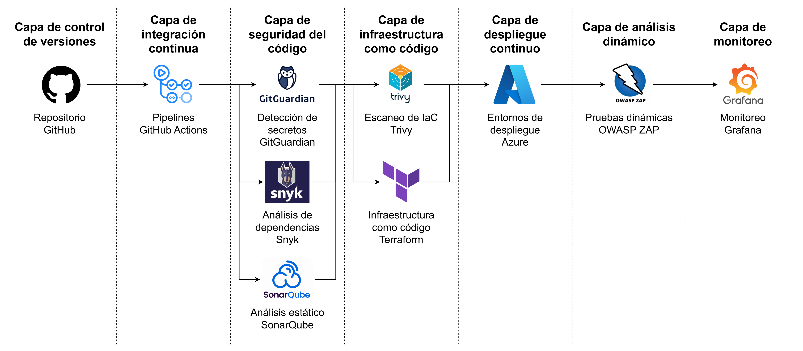
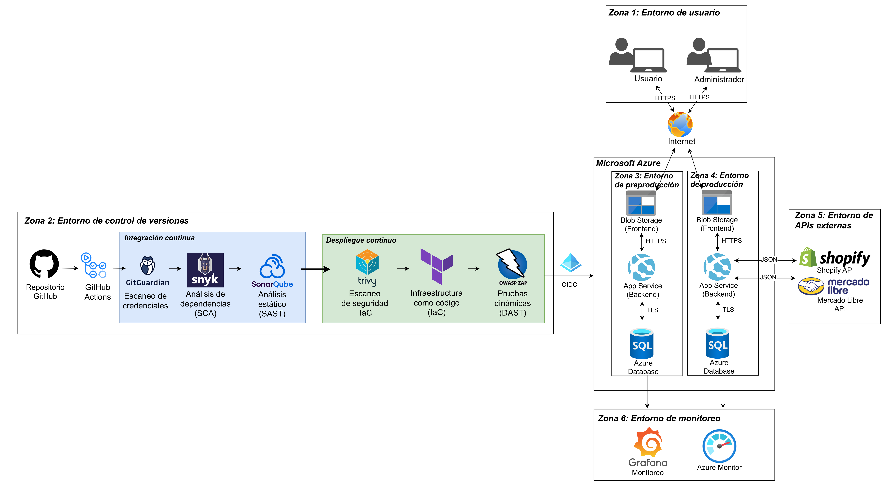
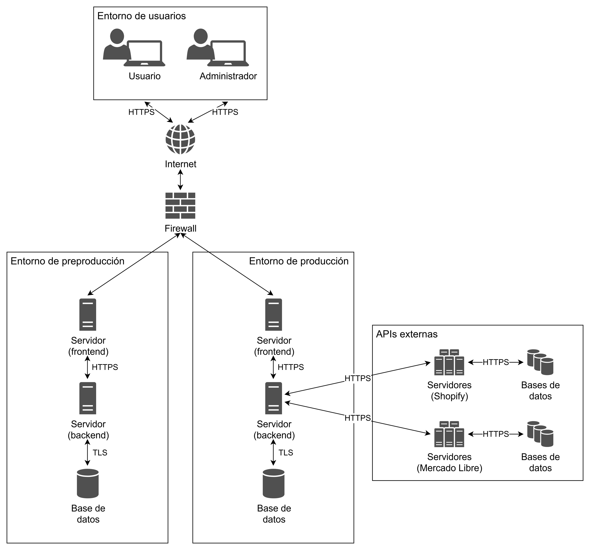
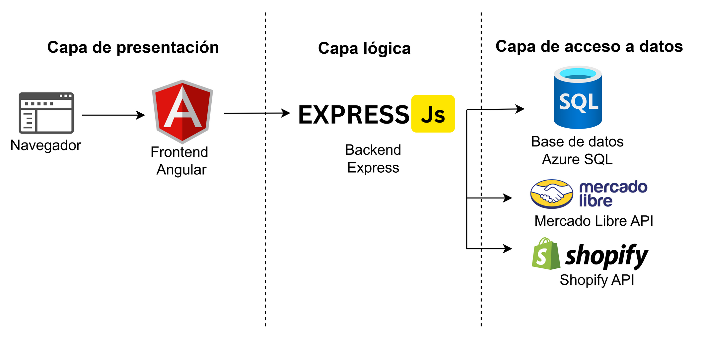
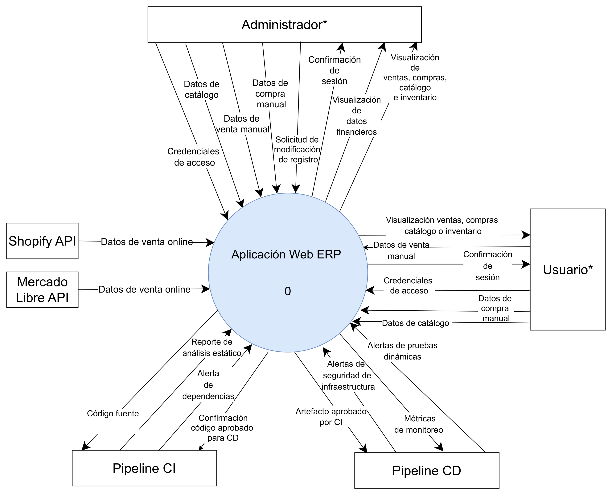
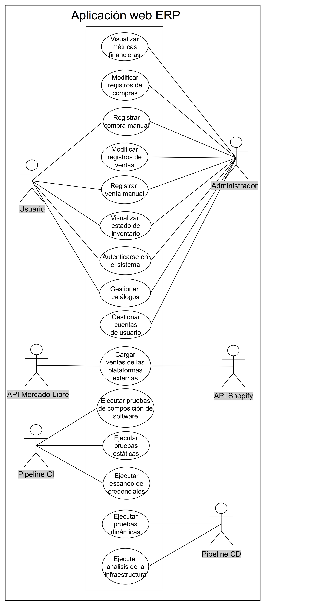
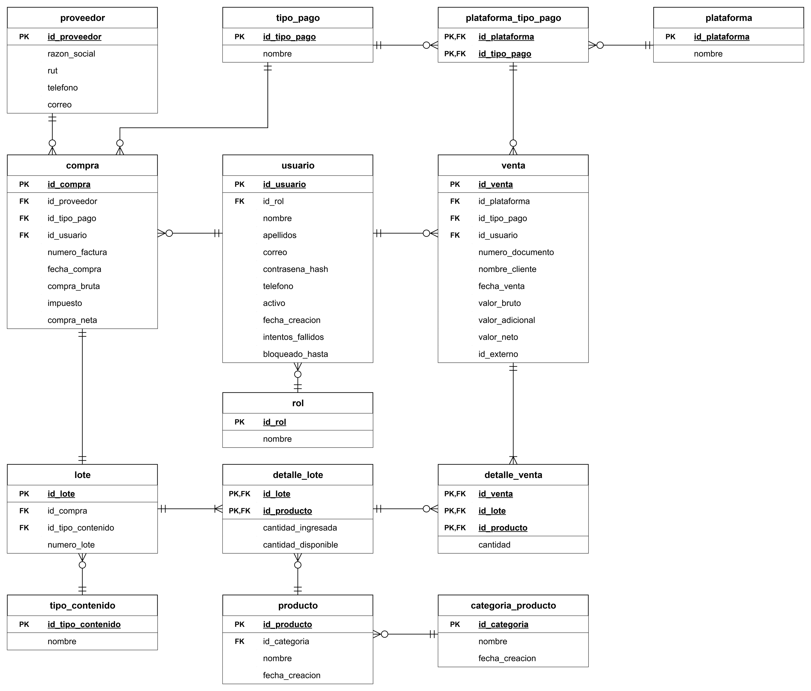

# Documentación del sistema

Esta carpeta reúne los diagramas de contexto, casos de uso, arquitecturas, modelo relacional y pipelines del sistema.

## Arquitectura DevSecOps por capas

El proceso se organiza en capas de control de versiones, integración continua, seguridad del código, infraestructura como código, despliegue continuo, análisis dinámico y monitoreo.



## Modelo arquitectónico con enfoque DevSecOps

GitHub Actions ejecuta los controles de integración y despliegue para cada componente. El cambio pasa por detección de secretos, análisis de dependencias, pruebas y análisis estático antes de publicar el artefacto. El despliegue incorpora el análisis de infraestructura, la publicación en preproducción, las pruebas dinámicas y la publicación en producción.



El backend exporta métricas mediante `/metrics`. La configuración de los paneles de Grafana y sus fuentes de datos se administra fuera de las carpetas Terraform.

## Arquitectura física

El frontend y el backend se publican en servicios separados. El usuario accede a la interfaz mediante HTTPS, la interfaz consulta la API y el backend se conecta a Azure SQL mediante una conexión cifrada. Las integraciones externas se consultan desde el backend.



## Arquitectura lógica

La presentación se implementa con Angular, la lógica de negocio con Express y el acceso a datos con Sequelize y Azure SQL. El backend organiza las operaciones en rutas, controladores, middleware y modelos, manteniendo una única aplicación para los módulos del ERP.



## Diagrama de contexto

El diagrama sitúa la aplicación ERP frente a sus usuarios y sistemas externos. Muestra el intercambio de información con el administrador, los usuarios, las plataformas de ventas y los pipelines de integración y despliegue.



## Casos de uso

Los casos de uso presentan las funciones del sistema y su relación con los actores. Incluyen la autenticación, el registro de compras y ventas, la consulta del inventario, la gestión de cuentas y catálogos, y las actividades de los pipelines.



## Base de datos

El sistema utiliza Azure SQL y accede a los datos mediante Sequelize, con el dialecto SQL Server. Las tablas relacionan las compras, los lotes y las ventas para consultar el origen de los productos y sus existencias.



### Organización de los datos

| Grupo | Tablas | Función |
| --- | --- | --- |
| Acceso | `usuario`, `rol` | Almacenar las cuentas y sus roles. |
| Catálogos | `producto`, `categoria_producto`, `proveedor`, `plataforma`, `tipo_pago`, `plataforma_tipo_pago`, `tipo_contenido` | Definir los productos y las opciones utilizadas en las operaciones. |
| Compras e inventario | `compra`, `lote`, `detalle_lote` | Relacionar cada compra con su proveedor, lote y cantidades disponibles por producto. |
| Ventas | `venta`, `detalle_venta` | Almacenar la venta y sus productos, cantidades y lotes de origen. |
| Integraciones | `integracion` | Conservar la última sincronización y el token de renovación de la plataforma correspondiente. |

Cada compra tiene un lote asociado. El detalle del lote registra los productos y su disponibilidad. Los detalles de venta relacionan cada producto vendido con su lote, permitiendo actualizar el stock al registrar la operación.

## Estructura de carpetas

```text
docs/
├── README.md
└── imagenes/
    ├── logo-zona-gaucha.jpeg
    ├── arquitectura/          Arquitecturas física, lógica y DevSecOps
    ├── base-de-datos/         Modelo relacional
    ├── devsecops/             Flujos CI/CD y comparación de pipelines
    └── sistema/               Contexto y casos de uso
```

## Organización de las figuras

| Carpeta | Contenido |
| --- | --- |
| `imagenes/base-de-datos` | Modelo relacional. |
| `imagenes/devsecops` | Flujos de CI y CD y comparación entre DevOps y DevSecOps. |
| `imagenes/sistema` | Diagramas de contexto y casos de uso. |
| `imagenes/arquitectura` | Arquitecturas física, lógica y DevSecOps. |

[Proyecto](../README.md) · [Infraestructura](../infra/README.md) · [Backend](../backend/README.md)
